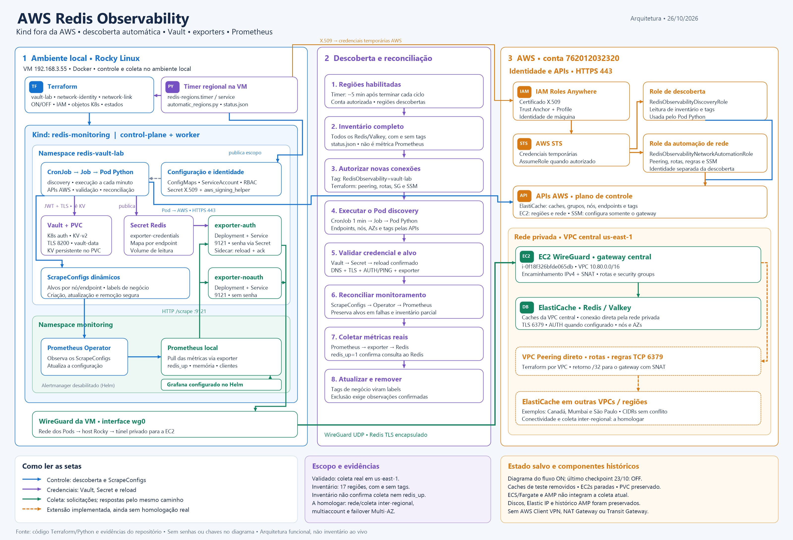

# aws_redis_observability

[Etapa OU: entrada automática das contas e teste de baixo custo](docs/ETAPA_OU_MONITORAMENTO.md).

[Criar Redis somente pelo Terraform: tags obrigatórias, governança e teste](docs/REDIS_SOMENTE_TERRAFORM.md).

[Cadastro de contas sem duplicidade: duas contas e evolução para Organizations](docs/CADASTRO_AUTOMATICO_CONTAS.md).

[Abrir PNG em alta resolução](imagens/arquitetura-projeto-atual.png) ·
[Abrir SVG editável](imagens/arquitetura-projeto-atual.svg).
O desenho mostra o fluxo em modo ON e identifica as extensões ainda não homologadas.

[Guia resumido: funcionamento, arquitetura e passo a passo](docs/GUIA_RESUMIDO_PROJETO.md).

[Descoberta automática de regiões e conectividade](docs/DESCOBERTA_REGIOES_AUTOMATICA.md):
configuração YAML, timer na VM, identidade de máquina e estados Terraform por VPC.

**Comece aqui:** [guia de teste manual, do Kind à AWS](docs/GUIA_TESTE_MANUAL.md)
e [diagrama ponta a ponta](docs/FLUXO_PONTA_A_PONTA.md).

Status verificado em 23/10/2026: [ponto de retomada](docs/STATUS_PROJETO.md).
Fluxo e limites da solução: [arquitetura](architecture.md).

Operação local por Terraform, incluindo Vault → Secret → exporter autenticado:
[ligar, parar e configurar](terraform/environments/vault-lab/README.md).
[Operação e ajustes para produção](docs/OPERACAO_E_PRODUCAO.md).
[Aceitação real do piloto e limites](docs/ACEITACAO_PILOTO.md).

Histórico de conectividade do Prometheus no Kind:
[piloto Client VPN São Paulo](docs/CLIENT_VPN_PILOTO.md).
O piloto foi validado e removido; consulte o [resultado](docs/CLIENT_VPN_RESULTADO.md).

Descoberta e monitoramento automatizados de instâncias AWS Redis em múltiplas contas no Kubernetes, utilizando Terraform, Python, Vault, redis_exporter e Prometheus Operator.

# AWS Redis Observability

Automated multi-account AWS Redis discovery and monitoring on Kubernetes using Terraform, Python, Vault, redis_exporter and Prometheus Operator.

## Objetivo

Desenvolver uma solução de observabilidade capaz de descobrir automaticamente instâncias Redis distribuídas em múltiplas contas e regiões AWS, configurando seu monitoramento no Prometheus sem intervenções manuais.

## Tecnologias

- Kubernetes / Kind
- Docker
- Terraform
- Python / boto3
- Prometheus Operator
- redis_exporter
- HashiCorp Vault
- AWS IAM / STS / ElastiCache
- Helm

## Arquitetura

O Terraform provisiona a infraestrutura de monitoramento. Um controller Python executado periodicamente no Kubernetes descobre recursos Redis nas contas AWS configuradas e reconcilia os targets do Prometheus Operator.

As tags AWS autorizadas são convertidas em labels de métricas, permitindo segmentação por projeto, ambiente e centro de custo.

As credenciais são gerenciadas pelo Vault.

## Ambientes

| Ambiente | Plataforma | Finalidade |
|---|---|---|
| Local | Rocky Linux + Kind | Desenvolvimento e validação |
| AWS | EKS | Integração e testes em nuvem |

## Critérios principais

- Descoberta dinâmica sem cadastro manual de Redis.
- Suporte a múltiplas contas e regiões AWS.
- Exporters separados para Redis autenticados e não autenticados.
- Credenciais protegidas e associadas corretamente a cada recurso.
- Reconciliação idempotente.
- Remoção automática de targets inexistentes.
- Monitoramento de novos Redis em até 5 minutos, validado por testes.

## Status

Piloto temporário Client VPN validado: VM e Pod Kind acessaram os Valkey de São
Paulo; discovery idempotente e `redis_up=1` no Prometheus local foram confirmados.
Os recursos da VPN foram removidos e a configuração anterior foi restaurada.
Redis, ECS/AMP e WireGuard existentes permanecem operacionais.
Consulte [estado, implantação e pendências](docs/CLIENT_VPN_PILOTO.md).
