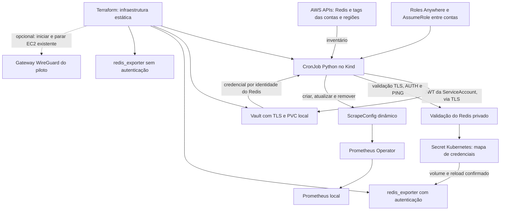
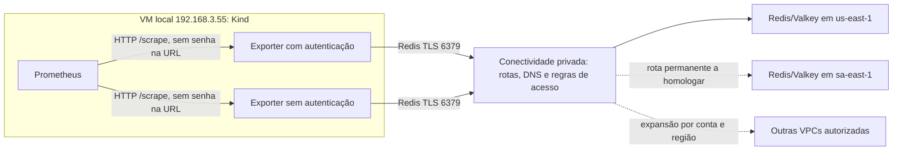

# Arquitetura do monitoramento Redis/Valkey

Ingresso de contas: [catálogo único e Organizations/StackSets](docs/CADASTRO_AUTOMATICO_CONTAS.md).
O inventário usa AssumeRole por conta; conectividade cross-account e validação
com uma segunda conta real permanecem pendentes.

Diagrama detalhado de servidores/rede e passo a passo do fluxo:
[FLUXO_PONTA_A_PONTA.md](docs/FLUXO_PONTA_A_PONTA.md).
Para executar o teste: [GUIA_TESTE_MANUAL.md](docs/GUIA_TESTE_MANUAL.md).

Atualizado em 23/10/2026. Este documento descreve o fluxo implementado e
identifica o que ainda depende de homologação. O piloto do ciclo seguro passou.
Estado de execução e ponto de retomada: [STATUS_PROJETO.md](docs/STATUS_PROJETO.md).
Operação ON/OFF por Terraform: [guia local](terraform/environments/vault-lab/README.md).
O hook local faz bootstrap/unseal ao ligar e retira Jobs/targets ao parar.
O pool autenticado confirma o reload em todos os Pods antes de publicar alvos.

## Configuração automática

O discovery consulta as APIs usando a identidade AWS configurada, verifica a
conta retornada por STS e descobre endpoints e características dos recursos.
As tags permitidas viram labels; endpoints não são cadastrados em Terraform.
O controller também verifica a saúde do exporter antes de alterar ScrapeConfigs.
Com `collect_nodes: true`, membros de replication groups viram targets próprios,
com labels de shard, papel e AZ. A credencial continua sendo a do grupo no Vault.
O inventário também permite grupos com cluster mode; a coleta por nó evita
depender de um endpoint de configuração para representar todas as AZs.

O caminho da credencial no Vault é determinístico:
`kv/redis-observability/<conta>/<região>/<tipo>/<nome>`. O processo que cria ou
rotaciona um Redis precisa manter essa credencial no Vault. Descobrir o Redis
não revela sua senha nem elimina essa integração com o provisionamento.

## Coleta das métricas

O Prometheus faz pull dos exporters; os exporters se conectam aos Redis.
As chamadas às APIs AWS não substituem a conectividade privada com os endpoints.
Cada rede precisa ter caminho de ida e volta, resolução DNS e regras de acesso
validados a partir dos Pods, incluindo possíveis sobreposições de CIDR.

Virgínia foi validada pelo WireGuard existente. São Paulo foi validado por
Client VPN temporária, removida após o piloto. Portanto, o caminho privado
permanente para todas as regiões ainda não está entregue.
No início da revisão a EC2 WireGuard estava parada, causando o timeout.
O Terraform final foi validado iniciando essa instância, restaurando a coleta
e parando-a no OFF. Ele não cria uma nova EC2 nem conexões entre outras VPCs.

## Responsabilidades e ciclo de vida

| Componente | Responsabilidade |
|---|---|
| Terraform | Namespace, RBAC, Vault/PVC, exporters, CronJob e modo ativo/inativo |
| Controller Python | Descoberta, filtro de rede, credenciais, validação e ScrapeConfigs |
| Vault | Armazenar credenciais e autenticar o controller por Kubernetes auth |
| Secret e sidecar | Projetar o mapa de senhas e confirmar o reload do exporter |
| Prometheus Operator | Transformar ScrapeConfigs em configuração de coleta |
| Rede privada | Permitir acesso TLS aos Redis aprovados em cada VPC |

1. **Criação:** recurso elegível descoberto → credencial no Vault → validação →
   Secret/reload → exporter saudável → ScrapeConfig → coleta com labels.
2. **Atualização:** novo inventário e nova credencial → validação antes de
   substituir o mapa → atualização do target. Falhas interrompem o ciclo;
   falha de reload/saúde aciona restauração do mapa anterior.
3. **Remoção:** ausência em dois inventários completos, separados por pelo menos
   60 segundos → remoção com UID/resourceVersion → retirada posterior da entrada
   do Secret. A credencial permanece no Vault para recriação. Inventário
   incompleto ou recurso apenas indisponível não autoriza exclusão.
4. **Pausa:** suspender discovery, encerrar Jobs do laboratório, retirar seus
   targets e aplicar zero réplicas. Preservar PVC, recuperação do Vault e states.
5. **Retomada:** restabelecer rede/identidade, ligar pelo operador do laboratório,
   aguardar unseal/estado ativo e validar a coleta.

## Separação do legado e limites

O laboratório Vault está em `redis-vault-lab`; o pipeline anterior está em
`redis-observability`. Ainda não foram unificados em um pipeline final.
O discovery legado inclui provisionamento ECS e precisa permanecer suspenso
durante a pausa para não recriar coletores.

Os coletores ECS/Fargate e o AMP anteriores formam outro caminho de coleta,
separado do Prometheus local. Eles não são requisito do fluxo central acima,
não foram removidos por esta implementação e precisam de decisão própria de
migração/desativação. Ver o [plano dos recursos anteriores](docs/PLANO_DESLIGAMENTO_ANTERIORES.md).

Foram comprovadas criação automática, coleta autenticada, propagação de tags,
rotação com senha antiga rejeitada, senha inválida sem alterar targets,
remoção/recriação reais e retomada do pipeline. A configuração final coletou
um nó em Virgínia com duas réplicas autenticadas confirmando o reload.
[Evidências e limites](docs/ACEITACAO_PILOTO.md).
Cluster mode e múltiplas AZs têm seleção por nós e cobertura unitária; a
homologação real com múltiplos membros é distinta do teste com cache de um nó.
Caches Redis sem replication group têm seleção por endpoint e testes unitários;
autenticação IAM Redis não está coberta. Sentinel autogerenciado não pertence ao inventário
ElastiCache. Ver [ajustes para produção](docs/OPERACAO_E_PRODUCAO.md).
