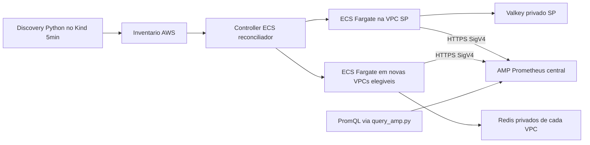

# AWS Redis Observability — Distributed Collector (fase 1 + controller v1)

> Pacote **aditivo** ao repositorio `aws_redis_observability`. Nao sobrescreve os manifests antigos e NAO altera a VPN.
>
> **IMPORTANTE:** esta entrega foi montada a partir do historico/arquivos compartilhados, NAO de um clone integral do repositorio privado. Antes de merge: revisar `git diff`, `terraform plan`, permissões IAM e custos. Nenhum `terraform apply` foi executado aqui.

## O problema solucionado pela arquitetura

O Prometheus no Rocky Linux (`192.168.3.55`) identifica um Valkey AWS em `us-east-1` (UP) e um cache Serverless em `sa-east-1` (DOWN). O Redis privado de Sao Paulo resolve para `172.31.x.x` e nao tem rota WireGuard. Uma VPN por regiao e peering manual nao escalam.

**Solucao:** coletor Fargate na MESMA VPC do Redis; `redis_exporter` faz TCP/TLS local; AWS Distro for OpenTelemetry (ADOT) coleta `/scrape` local e envia Prometheus Remote Write HTTPS/SigV4 para Amazon Managed Service for Prometheus (AMP). Nao existe acesso Redis entre regioes.

## O que esta pronto no pacote

| Arquivo | Papel |
|--|--|
| `terraform/central/` | workspace AMP + politica de recepcao cross-account (Terraform) |
| `terraform/region-bootstrap/` | ECS cluster, IAM execution/task/controller, CloudWatch, DynamoDB (Terraform em cada conta/regiao) |
| `terraform/controller-access/` | adiciona `sts:AssumeRole` a role Roles Anywhere existente (Terraform) |
| `terraform/pilot-sa-east-1/` | **piloto executavel** Fargate na VPC SP + regra SG TCP6379 gerida por Terraform |
| `controller/reconcile.py` | controller opt-in para criar/atualizar ECS services/SG de recursos AWS nas regioes preconfiguradas, sem novo Terraform por Redis |
| `kubernetes/Dockerfile.distributed` | imagem com discovery anterior + controller |
| `kubernetes/distributed-controller/cronjob.yaml` | CronJob paralelo, criado **suspenso**, a cada 5 min |
| `scripts/query_amp.py` | consulta PromQL HTTPS/SigV4 diretamente ao AMP sem Grafana |
| `tests/` | testes unitarios offline do controller |
| `docs/` | projeto, limitacoes, seguranca, sequencia e rollback |

## Limites relevantes (NAO escondidos)

1. **AMP nao e o Prometheus do Kind**: os novos samples de Fargate vao para **um novo backend de metricas Prometheus AMP**. Continuam consultaveis via PromQL (`scripts/query_amp.py`). Nao aparecem automaticamente no browser `http://192.168.3.55:19090`. Para uma UI local unificada sera necessaria uma camada de consulta federada ou um gateway autorizado de leitura AMP. Nao habilitamos uma publicacao insegura do Prometheus on-prem.
2. **Terraform bootstrap** e feito por conta/regiao habilitada; o controller cria runtime ECS services e SGs dinamicamente (com boto3). Se o requisito exigir literalmente que CADA SG/service seja declarado no estado Terraform, e necessaria uma pipeline reconciliadora Terraform em vez do controller SDK. Esta distinção deve ser aprovada na arquitetura.
3. **Credenciais:** exportador autenticado exige Secret ARN em AWS Secrets Manager; o valor precisa ser sincronizado a partir do Vault por integracao separada, que nao esta provisionada sem URL, auth mount/policies e mecanismo de identidade Vault. NAO escrever senhas no Terraform, Git, task definition ou labels.
4. **ElastiCache Serverless sem UserGroup** e o caminho v1 testavel. Replication group nao-cluster tambem e detectado/enriquecido, mas os com AUTH exigem Secret ARN preexistente. Cluster mode habilitado/Sentinel ainda nao sao suportados neste controller.
5. **Redes privadas:** uma task Fargate precisa de saida HTTPS para AMP, ECR/GHCR, CloudWatch. No lab `assign_public_ip=true` exige subnet com rota IGW. Em producao usar subnets privadas NAT ou VPC endpoints e image pull compativel. A criacao de um Redis em VPC **sem egress** nao pode atingir `redis_up=1` ate a rede estar preparada, embora a deteccao funcione.
6. **SLA:** scan a cada 5 minutos, mas criacao/cold start Fargate/ingestao pode superar 5 min. Critério de "descoberta em ate 5min" difere de "metricas em ate 5min".
7. **Remocao:** `--prune` exige duas execucoes de discovery completas consecutivas, estado persistente DynamoDB, ativa explicitamente a delecao SOMENTE de ECS Services com tag `ManagedBy=redis-observability-controller`. Nao exclui Redis nem a infraestrutura Terraform. SGs e task revisions velhos precisam de rotina de garbage-collection separada.
8. **Nao aplicar ainda** `--apply` ao controller antes de testar o piloto, verificar egress e desativar o piloto para nao gerar duas series duplicadas.

## Ordem de implantacao, um passo por vez

Antes de copiar este pacote, **sincronize o codigo do Rocky**: houve modificacoes locais em `targets.py`, `scrapeconfig.py`, IAM, RBAC e CronJob que podem nao estar no commit Windows `faed804`. Rode `git status --short`, faca commit/push do Rocky e pull do Windows, sem incluir segredos e arquivos acidentais.

1. Copiar pasta `distributed-collector/` para a raiz do projeto no Windows; commit no Git.
2. Rodar `bash distributed-collector/scripts/verify_package.sh` (requer PyYAML, boto3, terraform instalado para fmt).
3. Em `terraform/central`: `cp terraform.tfvars.example terraform.tfvars`; `terraform init && terraform plan -out=plan.tfplan`; revisar custo e aplicar conscientemente. Guardar `workspace_arn`, `remote_write_endpoint`, `query_endpoint`.
4. Em `terraform/region-bootstrap`: configurar Sao Paulo, passar `workspace_arn`, controller IAM role ARN, `terraform init && terraform plan`, aplicar; guardar 6 outputs.
5. Em `terraform/controller-access`: anexar politica `sts:AssumeRole` apenas para os roles regionais autorizados; terraform init/plan/apply.
6. Em `terraform/pilot-sa-east-1`: ajustar `terraform.tfvars` com os outputs anteriores, VPC e subnet ids **existentes**; `terraform plan` para verificar SG, ingress 6379 (somente SG do coletor), task/service ECS; aplicar somente apos revisao de custos.
7. Validar CloudWatch ECS logs e `scripts/query_amp.py --endpoint <query_endpoint> --promql 'redis_up{job="redis-aws-distributed"}'`. O retorno deve incluir `aws_region="sa-east-1"` e valor 1.
8. Deletar o piloto com `terraform destroy` (somente neste diretorio/state) antes de ativar o controller. Nao deleta o Serverless existente.
9. Preencher `controller/config.yaml` a partir do exemplo com outputs de region-bootstrap. Evite commitar credenciais; nao coloque `external_id` em Git. Confirmar `--dry-run` com o arquivo `/tmp/aws-inventory-test.json` ja gerado pelo discovery existente.
10. Buildar imagem nova, instalar CronJob **suspenso**, revisar dry-run e controles IAM, ativar via `kubectl patch` somente quando estiver pronto. `--prune` deve permanecer inativo ate testar resiliencia.
11. Onboard nova conta ou regiao: aplicar `region-bootstrap` nela via Terraform uma vez, estender policy AMP e trust/policy do controller, incluir na config de discovery e no controller; apos isso novo Redis nao requer Terraform manual.

Consulte `docs/OPERACAO.md` e `docs/SEGURANCA_E_LACUNAS.md` para passos, custos e controles.
