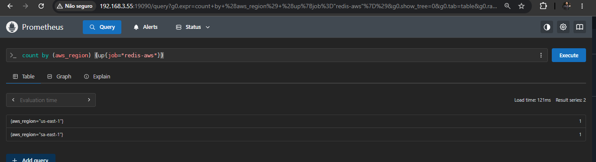
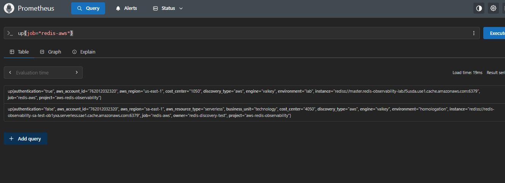
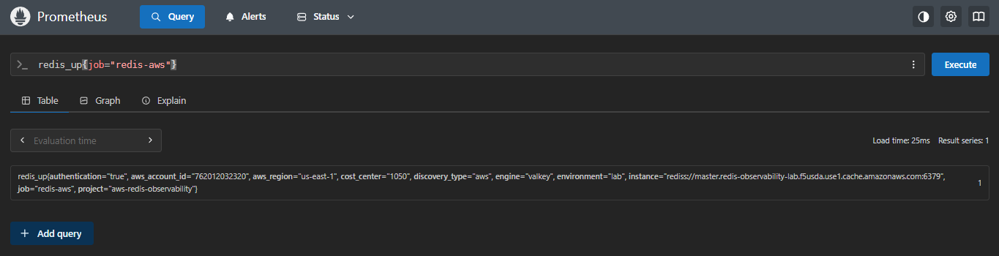

# Runbook de implantacao e aceite

## Precheck — salvar ambiente anterior

```bash
cd /root/projetos/aws_redis_observability
git status -sb
git log -1 --oneline
kubectl get cronjob redis-discovery-aws -n redis-observability
kubectl get scrapeconfigs -n redis-observability -l discovery-source=aws
kubectl get pods -n monitoring
```

Preserve todos os recursos existentes. Nao apague o WireGuard/EC2; use como comparador para o RG Virgínia.

## Terraform — primeiro somente plan

Execute cada pasta em separacao. Nao coloque todos os subprojetos no mesmo Terraform state.

```bash
cd distributed-collector/terraform/central
cp terraform.tfvars.example terraform.tfvars
# preencher/remover ws-REPLACE em outros tfvars conforme outputs
terraform init
terraform fmt -recursive
terraform validate
terraform plan -out=tfplan
terraform show tfplan
# confirmar custos AMP e politica de acesso; so entao terraform apply tfplan
terraform output
```

Repetir em `region-bootstrap` e `controller-access`. Em `pilot-sa-east-1`, validacao do SG antes de aplicar:

```bash
terraform plan -out=tfplan
terraform show tfplan | less
```

Esperado: criar somente SG proprio coletor, adicionar regra 6379 de origem SG collector no SG existente `sg-0ec65f2b300695795`, ECS service/task. **NAO** alterar VPC/SG por substituicao, excluir Valkey, mudar rotas, peering ou WireGuard.

## Validar o piloto

```bash
aws ecs describe-services --profile redis-observability-admin --region sa-east-1 --cluster redis-observability-distributed --services redis-observability-sa-pilot --query 'services[].{running:runningCount,desired:desiredCount,events:events[:3].message}' --output json
aws logs describe-log-streams --profile redis-observability-admin --region sa-east-1 --log-group-name /ecs/redis-observability-distributed --order-by LastEventTime --descending --max-items 5
```

Com `runningCount=1`, consultar AMP:

```bash
python distributed-collector/scripts/query_amp.py \
  --profile redis-observability-admin \
  --region us-east-1 \
  --endpoint 'https://aps-workspaces.us-east-1.amazonaws.com/workspaces/ws-REPLACE' \
  --promql 'redis_up{job="redis-aws-distributed",aws_region="sa-east-1"}'
```

Observe metricas `up` vs `redis_up`: `up` significa scraping do exporter; `redis_up` confirma TCP/TLS/Redis. Confirmar business_unit, cost_center, environment.

## Dry-run controller (sem alteracoes na AWS)

Use o INVENTARIO existente no Rocky, gerado com Roles Anywhere:

```bash
source .venv-aws/bin/activate
python -m discovery.aws_discovery > /tmp/aws-inventory-test.json
python distributed-collector/controller/reconcile.py \
  --config distributed-collector/controller/config.yaml \
  --inventory /tmp/aws-inventory-test.json
```

O controller lista SG/servicos que CRIARIA; NUNCA usar `--apply` em maquina local antes de verificar role de provisionamento.

## Deploy Controller no Kind (passo opt-in)

```bash
docker build -f distributed-collector/kubernetes/Dockerfile.distributed -t redis-discovery-aws:distributed-v1 .
kind load docker-image redis-discovery-aws:distributed-v1 --name redis-monitoring
cp distributed-collector/controller/config.yaml distributed-collector/kubernetes/distributed-controller/controller-config.yaml
kubectl apply -k distributed-collector/kubernetes/distributed-controller/
kubectl get cronjob redis-distributed-controller -n redis-observability
# suspend MUST be true. Only after pilot removed, role/IAM and dry-run validated:
kubectl patch cronjob redis-distributed-controller -n redis-observability -p '{"spec":{"suspend":false}}'
```

**Atenção:** CronJob é `--apply` quando ativado; não executar manualmente a Job template para dry-run. Usar script Python local sem `--apply`.

## Quando alguem criar um novo Redis

O Discovery AWS existente consulta a conta/regiao configuradas; o novo Controller cron consulta o mesmo inventario e cria um servico ECS na VPC do cache (se suportado e subnets tiverem egress). O ADOT scrape ocorre localmente e os dados sao enviados ao AMP. Nao precisa novo WireGuard ou novo Terraform por Redis na regiao habilitada.

Verificar:

```bash
kubectl get jobs -n redis-observability --sort-by=.metadata.creationTimestamp
kubectl logs -n redis-observability job/<job-distributed>
aws ecs list-services --region sa-east-1 --profile redis-observability-admin --cluster redis-observability-distributed
```

## Rollback

1. `kubectl patch cronjob redis-distributed-controller -n redis-observability -p '{"spec":{"suspend":true}}'`.
2. Em producao, desativar primeiro o modo de prune; `--prune` jamais e necessario para rollback emergencial.
3. Terraform pilot: `terraform destroy` somente dentro `pilot-sa-east-1`, apos confirmar state/plan. Isso nao apaga o cache, mas removera SG do coletor e ingress SG que ele criou.
4. `terraform destroy` de `central` SOMENTE apos desligar todos os coletores que dependem do AMP; destruicao perde retencao.
5. CronJob original `redis-discovery-aws` e Prometheus Kind nao foram alterados neste pacote.

## Evidencias pre-migracao

Estas capturas sao originais fornecidas pelo projeto e demonstram **descoberta AWS em 2 regioes**, nao coleta bem-sucedida em Sao Paulo:







O AMP com collector Fargate tera evidencias separadas apos o teste de integracao real.
