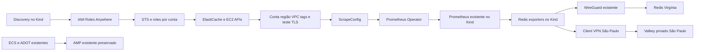

# Coleta AWS no Prometheus do Kind — piloto testado e removido

Estado em 22/10/2026: **piloto temporário validado e removido**, conforme a
autorização posterior do usuário. VM e Pod acessaram os dois Valkey de São
Paulo com TLS; o Prometheus local recebeu `redis_up=1` e o discovery foi
idempotente. O Terraform removeu os nove recursos exclusivos da VPN; os dois
certificados ACM do teste também foram removidos. CronJob e ConfigMap foram
restaurados exatamente. Redis, ECS/AMP e WireGuard existentes foram preservados.
Consulte o [relatório e as evidências](CLIENT_VPN_RESULTADO.md).
O exercício completo ainda tem os requisitos pendentes indicados ao final.

## Ambiente inspecionado

- Rocky Linux `192.168.3.55`, Kind `redis-monitoring`, contexto `kind-redis-monitoring`.
- Docker Kind `172.22.0.0/16`; Pods `10.244.0.0/24` e `10.244.1.0/24`.
- Rede local efetiva `192.168.0.0/22`; existem outras bridges Docker `/16`.
- WireGuard `wg0`: `172.27.80.0/24`, rota para `10.80.0.0/16` preservada.
- São Paulo: VPC `vpc-0eb95c9e597551a70`, `172.31.0.0/16`.
- Subnet do piloto: `subnet-00b359872fbcc41ac`, `172.31.0.0/20`, `sa-east-1a`.
- SG Redis existente: `sg-0ec65f2b300695795`.
- Três Serverless foram listados: `redis-observability-sa-test`,
  `redis-observability-v5-demo-02` e `redis-observability-v5-e2e`.
- Discovery atual v5: um ciclo a cada cinco minutos; inventário executado sem
  erros, com dois objetos em Virgínia e três em São Paulo.
- Os três Services ECS de São Paulo estavam `ACTIVE`, `desiredCount=1` e
  `runningCount=1` na inspeção; isso não comprova ingestão recente no AMP.
- Services existentes incluem `redis-exporter-aws`, `redis-exporter-auth` e
  `redis-exporter-noauth`. O exporter AWS existente é preservado para Virgínia.
- Não havia Client VPN nem certificados ACM em São Paulo.

O checkout Windows estava atrás da VM em suporte Serverless e roteamento.
Os fontes públicos atuais da VM foram reaproveitados. Exclusões locais
preexistentes de `distributed-collector/` não fazem parte desta alteração.

## Arquitetura

Antes: Virgínia coletada localmente via WireGuard; São Paulo com exporters
ECS/Fargate + ADOT enviando ao AMP. AMP não é automaticamente consultável pelo
Prometheus local.

Depois da futura homologação: exporters no Kind consultam São Paulo por Client
VPN e Virgínia por WireGuard. Prometheus Operator reconcilia os ScrapeConfigs;
o Prometheus existente continua armazenando as métricas. ECS/AMP permanecem
operacionais durante o piloto, sem remoção ou recriação.



IAM autentica chamadas de API; não fornece conectividade Redis. Client VPN é
regional e este endpoint autoriza somente a VPC piloto. Outras VPCs/contas
exigem conectividade e autorizações próprias. Não há Transit Gateway, NAT
Gateway, EC2 adicional nem novo Prometheus neste módulo.

## Preparação e custo

O módulo independente está em `terraform/environments/client-vpn`. Ele gerencia
somente endpoint, uma associação, uma autorização para a VPC, SG exclusivo,
uma regra adicional no SG Redis e logs exclusivos. Não importa Redis, ECS,
AMP ou WireGuard para seu state. Os certificados são importados pelo CLI,
fora do Terraform, evitando chaves privadas no state.

Catálogo oficial regional consultado na VM:
<https://pricing.us-east-1.amazonaws.com/offers/v1.0/aws/AmazonVPC/current/sa-east-1/index.json>
com vigência 01/10/2026. Associação: **US$ 0,15/h**; cliente conectado:
**US$ 0,05/h**. Uma associação com um cliente conectado por 730 h corresponde
a **US$ 146/mês**, ou US$ 4,80 por 24 h, antes de IPv4 público aplicável,
CloudWatch, transferência, impostos e câmbio. Desconectar o cliente não remove
a cobrança da associação. Reconsultar o catálogo antes de implantar.

**O piloto temporário foi autorizado e encerrado. Uma nova implantação exige
nova autorização de custos; o roteiro abaixo fica como procedimento reproduzível.**

## Implantação futura — executar sequencialmente na VM

### 1. Backup e pré-condições

Entrar na branch preparada, conferir `git status` e preservar os arquivos `.bak`
da VM. Registrar os recursos antes de alterar qualquer coisa:

```bash
cd /root/projetos/aws_redis_observability
export AWS_PROFILE=redis-observability-admin AWS_DEFAULT_REGION=sa-east-1 AWS_PAGER=''
aws sts get-caller-identity
backup_dir=/root/redis-vpn-backup-$(date +%Y%m%d-%H%M%S)
install -d -m 700 "$backup_dir"
kubectl get cronjob redis-discovery-aws -n redis-observability -o yaml > "$backup_dir/cronjob.yaml"
kubectl get configmap redis-discovery-controller-files -n redis-observability -o yaml > "$backup_dir/controller-files.yaml"
kubectl get scrapeconfigs -n redis-observability -l discovery-source=aws -o yaml > "$backup_dir/scrapeconfigs.yaml"
ip -4 route > "$backup_dir/routes.txt"
iptables-save > "$backup_dir/iptables.txt"
docker network inspect kind
kubectl get nodes -o custom-columns=NAME:.metadata.name,PODCIDR:.spec.podCIDR
kubectl get svc kubernetes -o wide
```

Conferir também rotas em outras tabelas (`ip rule; ip route show table all`),
Services Kubernetes, redes corporativas e todas as VPCs. O CIDR proposto é
`172.28.240.0/22`; não se sobrepõe às rotas observadas, mas requer essa revisão
final antes do apply. São Paulo e uma VPC não usada em Virgínia usam
`172.31.0.0/16`: não anunciar simultaneamente esse destino por dois túneis.

### 2. Certificados e Terraform

Instalar OpenVPN compatível com a versão Rocky, habilitando EPEL somente se
necessário. Não alterar SELinux ou desativar firewalld. Executar os scripts
com `bash` para evitar depender do bit executável do checkout Windows.

```bash
bash scripts/client_vpn_certificates.sh
pki=/etc/redis-observability/client-vpn/pki
server_arn=$(aws acm import-certificate --region sa-east-1 \
  --certificate "fileb://$pki/server.crt" \
  --private-key "fileb://$pki/server.key" \
  --certificate-chain "fileb://$pki/ca.crt" \
  --tags Key=Project,Value=redis-client-vpn-lab \
  --query CertificateArn --output text)
printf '%s\n' "$server_arn" > /etc/redis-observability/client-vpn/acm-server-arn
export TF_VAR_server_certificate_arn="$server_arn"
export TF_VAR_client_root_certificate_chain_arn="$server_arn"
export TF_VAR_client_public_cidr="$(curl -fsS https://checkip.amazonaws.com)/32"
terraform -chdir=terraform/environments/client-vpn init
terraform -chdir=terraform/environments/client-vpn plan -out=pilot.tfplan
# Revisar: uma associação, sem destruição/substituição de recursos existentes.
terraform -chdir=terraform/environments/client-vpn apply pilot.tfplan
```

Servidor e cliente usam a mesma CA exclusiva, permitindo reutilizar o ARN do
servidor para a cadeia de autenticação. A chave do cliente permanece na VM.
Guardar a CA/chaves fora do Git com permissões 0700/0600; não executar com
`set -x`. Planejar renovação dos certificados de 365 dias e revogação do cliente
em caso de comprometimento. Não usar a CA de Roles Anywhere como CA desta VPN.

O transporte padrão agora é TCP 443. No teste, UDP saiu da VM sem resposta;
a troca de protocolo exige recriar o endpoint AWS. A regra de transporte no SG
fica limitada ao IPv4 público `/32` observado. O gerador foi corrigido para
incluir `keyUsage` e `extendedKeyUsage` nos certificados; a conexão real validou
CA, nome, KU e EKU, sem desabilitar verificação TLS.

### 3. OpenVPN, split tunnel e systemd

```bash
endpoint_id=$(terraform -chdir=terraform/environments/client-vpn output -raw endpoint_id)
umask 077
aws ec2 export-client-vpn-client-configuration --region sa-east-1 \
  --client-vpn-endpoint-id "$endpoint_id" --query ClientConfiguration --output text \
  > /etc/redis-observability/client-vpn/exported.ovpn
install -d -m 700 /etc/openvpn/client
python3 scripts/client_vpn_configure.py \
  --exported /etc/redis-observability/client-vpn/exported.ovpn \
  --output /etc/openvpn/client/redis-sa.conf
restorecon -Rv /etc/openvpn /etc/redis-observability/client-vpn
systemctl enable --now openvpn-client@redis-sa
systemctl status openvpn-client@redis-sa --no-pager
ip -4 addr show tun-redis-sa
ip route get 172.31.0.1
ip route get 10.80.0.1
ip route show default
```

O arquivo gerado rejeita redirecionamento global, não instala DNS global e
aceita somente a rota explícita `172.31.0.0/16`. O serviço padrão OpenVPN usa
keepalive/reconexão; conferir a unidade distribuída pelo pacote e, se necessário,
adicionar um drop-in `Restart=on-failure` e `RestartSec=5`. Não sobrescrever uma
configuração já existente: o gerador usa criação exclusiva.

Resolver os nomes Redis com `getent ahostsv4 ENDPOINT`. Se o DNS atual já retorna
IPs privados, preservá-lo. Se uma zona privada exigir encaminhamento, configurar
resolução condicional apenas para a zona necessária e um DNS alcançável pela
VPN, revisando suas autorizações e SG. Não presumir que o resolver VPC está
alcançável nem criar Route 53 Resolver pago sem nova análise de custos.

Validar TLS com `openssl s_client -connect ENDPOINT:6379 -servername ENDPOINT
-verify_return_error </dev/null`. Para os recursos declarados noauth, exigir
`redis-cli --tls -h ENDPOINT -p 6379 PING` retornando `PONG`. Não passar senhas
na linha de comando. O PING é leitura operacional e não grava chaves Redis.

### 4. Caminho obrigatório dos Pods

O Pod sai pelo nó Kind, que normalmente faz SNAT para a rede Docker. O host
encaminha esse tráfego pela interface `tun-redis-sa`; MASQUERADE usa o IP cliente
da VPN. Na VPC, as regras de acesso usam o SG da associação Client VPN.

```bash
bash scripts/client_vpn_kind_forwarding.sh check
# Aplicar apenas se a inspeção mostrar necessidade das regras:
bash scripts/client_vpn_kind_forwarding.sh apply
kubectl apply -f kubernetes/examples/client-vpn-connectivity.yaml
kubectl wait --for=jsonpath='{.status.phase}'=Succeeded \
  pod/redis-client-vpn-check -n redis-observability --timeout=120s
kubectl logs -n redis-observability redis-client-vpn-check
```

O teste exige PONG dos dois recursos São Paulo de aceite e resolve seus nomes
dentro do Pod. Se não concluir, não habilitar a política. O script de firewall
adiciona somente regras identificadas por comentário e limitadas à rede Kind,
destino VPC e porta 6379. Não limpa tabelas, não modifica WireGuard e não muda
a política global FORWARD. O script deve ser reaplicado após reinício ou reload
de firewall; depois da homologação, usar uma unidade oneshot com
`After=docker.service openvpn-client@redis-sa.service`, `ExecStart=bash ... apply`
e `ExecStop=bash ... remove`. Verificar também o backend nftables/firewalld:
uma regra ACCEPT em DOCKER-USER não prova que outras chains permitem o tráfego.

### 5. Discovery, IAM e migração do CronJob

Roles Anywhere/certificados existentes continuam fornecendo credenciais
temporárias. Para contas adicionais, `role_arn` configura STS AssumeRole com
trust explícita na conta destino. Não usar SSO humano nem credencial estática
no CronJob. A role de discovery precisa de `ec2:DescribeSubnets` em ambas as
regiões além das permissões ElastiCache existentes. Verificar a policy atual
antes de incorporar essa leitura; o provisionador ECS continua separado.

Em `discovery/config/collection-routing.yaml`, alterar somente o `enabled` do
piloto para `true` após o teste dos Pods. Novos targets são autorizados por:
conta + região + VPC + tag `RedisObservability=enabled`. Para Serverless noauth,
exigir também `RedisObservabilityAuth=noauth` e ausência de UserGroup; estado
desconhecido nunca é convertido silenciosamente em noauth. A tag é declaração
operacional e deve corresponder a um PING efetivamente homologado.

Não cadastrar nomes Redis na política para novos recursos. O único nome
mantido explicitamente é o alvo Virgínia já homologado, para compatibilidade.
O filtro confere todos os IPs retornados pelo DNS contra os CIDRs privados
autorizados e testa TCP/TLS a partir do Job. Falha de rede aborta o ciclo antes
do reconciliador, preservando a configuração anterior.

```bash
source .venv-aws/bin/activate
python -m unittest discover -s discovery/tests -v
docker build -f discovery/Dockerfile.aws -t redis-discovery-aws:local-v6-vpn .
kind load docker-image redis-discovery-aws:local-v6-vpn --name redis-monitoring
```

O ConfigMap existente também contém o template ECS. **Preservar esse campo**:
editar somente `aws-accounts.yaml` e `collection-routing.yaml`, copiando os
arquivos revisados, sem substituir o template vigente por uma versão antiga.
O manifesto `controller-files.configmap.yaml` é um snapshot do ambiente com a
política desabilitada; para produção, renderizar a política habilitada atual.

```bash
# Editar somente as chaves correspondentes e revisar o diff antes de salvar:
kubectl edit configmap redis-discovery-controller-files -n redis-observability
kubectl apply -f kubernetes/aws-discovery/rbac-writer.yaml --dry-run=server
kubectl apply -f kubernetes/aws-discovery/cronjob.yaml --dry-run=server
# Após conferir que não há Job ativo, aplicar e executar um Job manual:
kubectl apply -f kubernetes/aws-discovery/rbac-writer.yaml
kubectl apply -f kubernetes/aws-discovery/cronjob.yaml
job=redis-vpn-check-$(date +%s)
kubectl create job --from=cronjob/redis-discovery-aws "$job" -n redis-observability
kubectl wait --for=condition=complete "job/$job" -n redis-observability --timeout=300s
kubectl logs "job/$job" -n redis-observability
```

O pipeline v6 reconcilia targets locais primeiro e executa ECS em **dry-run**
depois. Não interrompe os Services existentes, mas suspende novos
provisionamentos automáticos ECS enquanto o piloto for usado. Não reaplicar
`rbac.yaml` antigo sobre o writer: o writer tem nome próprio e somente
get/list/create/patch. Nenhuma permissão delete foi adicionada.

Reexecutar o Job, exigir `UNCHANGED` na segunda execução e conferir ausência de
ScrapeConfigs duplicados. Nomes determinísticos mantêm o hash dos targets
existentes. Secrets não entram nos ScrapeConfigs, labels ou ConfigMaps.

### 6. Prometheus existente

Usar um port-forward temporário para o Service já instalado, sem criar servidor:

```bash
kubectl port-forward -n monitoring svc/monitoring-kube-prometheus-prometheus 19090:9090
# Em outro terminal:
python scripts/verify_local_redis.py --url http://127.0.0.1:19090 --names \
  redis-observability-lab redis-observability-sa-test redis-observability-v5-e2e
```

Consultas: `redis_up`, `redis_up{aws_region="sa-east-1"}`,
`redis_up{aws_region="us-east-1"}`, `redis_up{aws_account_id="762012032320"}`,
`redis_memory_used_bytes`. Exigir `redis_up=1`, amostras de origem com menos
de 120 s e labels `aws_account_id`, `aws_region`, `redis_name`,
`aws_resource_type`, `environment`, `project` e `cost_center` quando disponível.
`up=1` isolado só confirma scrape HTTP do exporter, não conexão Redis.

O verificador usa `timestamp(redis_up)` para conferir a idade da amostra real,
evitando confundir o horário de avaliação da consulta com o último scrape.
As tags de negócio vêm da allowlist configurável de `aws-accounts.yaml`.

## Expansão e diagnóstico

- Nova conta: configurar read role, trust e permissão STS na origem, incluir a
  conta no inventário/allowlist e validar conectividade privada separadamente.
  Segunda conta ainda não foi homologada.
- Nova região/VPC: criar caminho privado específico, conferir sobreposições,
  adicionar `local_networks` desabilitada, testar Pod e só então habilitar.
- Novo Redis numa rede autorizada: aplicar tags de opt-in/autenticação corretas;
  discovery não depende de lista manual de endpoints. Validar a primeira coleta.
- VPN: `journalctl -u openvpn-client@redis-sa`, estado da associação AWS,
  validade dos certificados, `ip route get IP`, autorização da VPC e SG.
- DNS: comparar `getent` no host e `nslookup` no Pod. Não trocar DNS global.
- Rede: comparar host e Pod; conferir SNAT do nó Kind, DOCKER-USER, nftables,
  firewalld, NACL e SG. Só corrigir a regra que bloqueia o caminho comprovado.
- IAM: logs do Job, validade do certificado Roles Anywhere, `GetCallerIdentity`,
  trust e permissões `DescribeSubnets`; não substituir por chaves permanentes.
- Scrape: selectors do Prometheus/namespace, Service do exporter, `/scrape`, TLS
  e credenciais. Não usar `--skip-tls-verification` como solução definitiva.
- Multi-AZ: subnets nas três AZs foram observadas; isso não comprova failover.
  Teste de failover real não foi executado nem faz parte deste piloto preparado.

## Rollback e teardown exclusivo da VPN

Primeiro restaurar o ConfigMap/CronJob salvos e confirmar Virgínia/ECS/AMP.
Os ScrapeConfigs novos São Paulo podem permanecer STALE por desenho do
reconciliador. Listar os objetos e revisar target-id/ownership; remover somente
os criados pelo piloto, após autorização de exclusão. Não remover Virgínia.

```bash
bash scripts/client_vpn_kind_forwarding.sh remove
systemctl disable --now openvpn-client@redis-sa
terraform -chdir=terraform/environments/client-vpn plan -destroy -out=teardown.tfplan
# Revisar o plano; só após autorização de exclusão:
terraform -chdir=terraform/environments/client-vpn apply teardown.tfplan
```

O state dedicado limita a remoção aos recursos exclusivos do piloto e à regra
SG que ele criou. Não executar destroy nos diretórios AWS/ECS anteriores.
Após a destruição do endpoint, conferir que o certificado ACM importado não
está em uso e remover exclusivamente seu ARN salvo. Certificados locais e
backups requerem política própria de retenção/revogação. Apenas parar OpenVPN
não elimina a cobrança da associação AWS.

## Evidências e limites de aceite

Executado: Terraform apply e destroy reais; cliente OpenVPN TCP; PONG com TLS
1.3 na VM e PING/TLS no Pod; imagem v6 carregada nos nós; dois Jobs reais de
discovery, com quatro `UNCHANGED` no segundo; Prometheus local saudável nos
três recursos de aceite; AMP com os três recursos de São Paulo saudáveis;
rollback e confirmação de state vazio, endpoint/SG/certificados ausentes.
Nenhuma regra adicional de firewall/NAT no host foi necessária: o MASQUERADE
Docker existente já permitiu o tráfego dos Pods. Foram executados 45 testes
na VM; a suíte local passou com 47, incluindo os testes de segurança do rollback.

Ainda não homologado: failover real, segunda conta, SLO ponta a ponta de cinco
minutos e suporte de memória Serverless via exporter. `INFO memory` retornou
string vazia no Serverless; `redis_memory_used_bytes` foi observado apenas no
recurso baseado em nós de Virgínia. Não substituir essa ausência por zero.

O exercício original também exige Vault, remoção automática de targets,
cluster mode, Sentinel e prazo ponta a ponta de cinco minutos. Este piloto
validou conectividade/centralização de Serverless noauth; **não implementa nem
homologa esses requisitos restantes**. Auth continua usando o exporter AWS já
existente para Virgínia. A rota nova recusa targets autenticados até existir
mapeamento Vault → Secret → exporter homologado. STALE não é excluído, evitando
remoção acidental durante a migração. A agenda de cinco minutos mais o tempo
de discovery/Operator/scrape não garante, sozinha, o SLO estrito de cinco
minutos; medir o prazo real e reduzir o intervalo com margem se necessário.

Referências: [Client VPN / split tunnel](https://docs.aws.amazon.com/vpn/latest/clientvpn-admin/split-tunnel-vpn.html),
[autorização e SG](https://docs.aws.amazon.com/vpn/latest/clientvpn-admin/client-authorization.html),
[preços](https://aws.amazon.com/vpn/pricing/).
