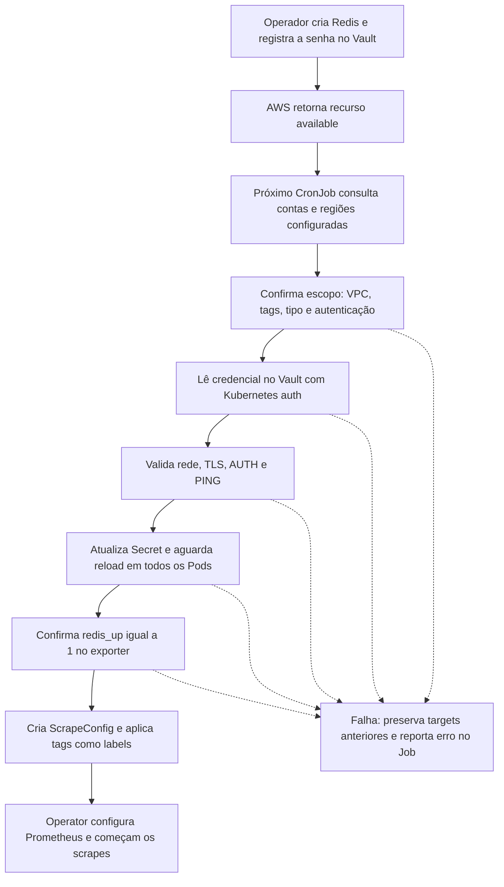
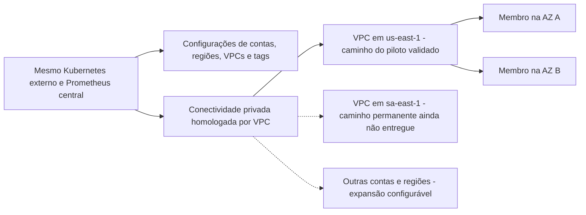

# Arquitetura ponta a ponta — Kind externo e Redis/Valkey AWS

O desenho mostra os componentes **quando o pipeline está ligado**. No último
checkpoint verificado (23/10/2026, 10:39 BRT), o pipeline e a EC2 estavam em OFF
e o cache temporário tinha sido removido. Caixas de teste/expansão não significam
recursos permanentemente ativos.

## Servidores, rede e coleta

```mermaid
flowchart LR
    subgraph computer ["Computador do operador"]
        terminal["Terminal: SSH para a VM"]
        browser["Navegador: Prometheus via túnel SSH"]
    end

    subgraph rocky ["Rocky Linux - VM 192.168.3.55 - fora da AWS"]
        terraform["Terraform e helpers de operação"]
        recovery["Diretório privado de recuperação do Vault"]
        hostWg["Rede do host - interface wg0"]
        subgraph kindCluster ["Kind redis-monitoring - control-plane e worker"]
            discovery["CronJob discovery - a cada minuto"]
            identity["Certificado X.509 e aws_signing_helper"]
            vault["Vault TLS - Kubernetes auth - KV-v2"]
            pvc["PVC vault-data - armazenamento local persistente"]
            credentials["Secret exporter-credentials"]
            authPool["Deployment exporter-auth - porta 9121 - sidecar de reload"]
            noauthPool["Deployment exporter-noauth - porta 9121"]
            configs["ScrapeConfigs dinâmicos - por nó ou endpoint"]
            operator["Prometheus Operator"]
            prometheus["Prometheus local - namespace monitoring"]
        end
    end

    subgraph awsAccount ["AWS - conta 762012032320 - região us-east-1"]
        iam["Roles Anywhere, STS e IAM"]
        api["APIs ElastiCache: inventário, características e tags"]
        subgraph vpc ["VPC vpc-086678957273bf941 - 10.80.0.0/16"]
            gateway["EC2 WireGuard existente - i-0f18f326bfde065db"]
            sg["Security groups e rotas privadas"]
            existing["Redis/Valkey existente - nó validado em us-east-1b"]
            temporary["Cache temporário opcional - um nó criado no teste"]
        end
    end

    terminal -->|"SSH 22"| terraform
    browser -->|"SSH local forward e kubectl port-forward"| prometheus
    terraform -->|"Objetos estáticos e ON/OFF"| discovery
    terraform -->|"Bootstrap e unseal"| vault
    recovery -->|"Material privado de recuperação"| terraform
    terraform -->|"API AWS: iniciar ou parar instância existente"| gateway
    vault --- pvc
    discovery --> identity
    identity -->|"HTTPS 443: credenciais temporárias"| iam
    discovery <-->|"HTTPS 443: metadados e tags"| api
    discovery <-->|"JWT Kubernetes e TLS 8200: credencial por Redis"| vault
    discovery -->|"Mapa após validação TLS e AUTH"| credentials
    credentials -->|"Volume somente leitura e reload confirmado"| authPool
    discovery -->|"Criar, atualizar e remover"| configs
    configs --> operator
    operator -->|"Configuração de scrape"| prometheus
    prometheus -->|"HTTP /scrape - sem senha na URL"| authPool
    prometheus -->|"HTTP /scrape"| noauthPool
    authPool <-->|"Redis TLS 6379 via rede do Kind"| hostWg
    noauthPool <-->|"Redis TLS 6379 via rede do Kind"| hostWg
    hostWg <-->|"Túnel WireGuard UDP pela rede externa"| gateway
    gateway <-->|"Roteamento privado e retorno"| sg
    sg <-->|"Redis TLS 6379"| existing
    sg <-.->|"Redis TLS 6379 quando criado"| temporary
```

O controller também testa a conectividade/TLS/AUTH dos Redis antes de publicar
um target; esse acesso privado usa o mesmo caminho de rede dos exporters.
O WireGuard encapsula o tráfego: o TLS Redis termina no ElastiCache, não na EC2.
Os nós Kind são containers na VM; não são instâncias EC2.

As subnets privadas documentadas são `10.80.10.0/24` e `10.80.20.0/24`.
O subnet group permite ao ElastiCache escolher os nós nessas redes. Ter duas
subnets **não significa** que o fixture de um nó seja Multi-AZ.
O NAT e a origem vista pelo SG dependem da configuração existente dos nós/host/
gateway; confira as regras antes de expandir. A porta UDP do WireGuard é a
configurada no ambiente, não a porta SSH 2222 de administração da EC2.

## Quatro fluxos diferentes

| Fluxo | Caminho | Finalidade |
|---|---|---|
| Operação | Terminal → VM → Terraform → Kubernetes e API EC2 | Ligar/parar e fazer bootstrap |
| Descoberta | Pod → Roles Anywhere/STS → APIs AWS | Descobrir nomes, nós, endpoints, características e tags |
| Credencial | Pod → Vault → Secret → volume do exporter | Disponibilizar senha sem colocá-la na URL/state |
| Métricas | Prometheus → exporter → rede privada → Redis | Fazer pull de INFO/métricas e armazenar no Prometheus local |

O acesso HTTPS às APIs AWS não depende do túnel privado do Redis. Por isso,
discovery pode listar caches mesmo quando a EC2 WireGuard está parada. Essa
listagem, sozinha, não comprova acesso aos dados Redis.

## O que acontece quando você cria um Redis

O helper de teste tem nome fixo para limitar criação/remoção ao fixture; o
controller seleciona recursos por conta, região, VPC e tags, sem cadastrar
endpoints. Uma senha ausente ou incorreta impede publicar o target autenticado.

Na exclusão, dois inventários completos confirmam a ausência; o ScrapeConfig
é retirado e depois a entrada é removida do Secret, respeitando retenção. A
credencial no Vault permanece para recriação. OFF suspende o discovery, encerra
Jobs, remove targets do pipeline, escala Deployments para zero e, se configurado,
para a EC2. Preserva PVC, Secrets, recuperação e states.

## Multi-AZ, múltiplas regiões e produção

O último desenho é **a expansão**, não o inventário atual do piloto. Com
`collect_nodes: true`, cada membro do replication group pode ter um target com
labels de AZ, nó e shard, usando a credencial do grupo. O teste real desta rodada
teve um membro; seleção com múltiplas AZs/shards e cluster mode tem testes
unitários. Serverless oferece endpoint de serviço, sem expor seus nós físicos.

Não foram criados TGW, Site-to-Site VPN, peering ou uma VPN permanente para São
Paulo nesta implementação. O Client VPN de São Paulo foi um piloto anterior,
já removido. ECS/Fargate/AMP antigos não fazem parte do fluxo novo de coleta
local e não foram destruídos. O namespace legado `redis-observability` conserva
recursos anteriores/identidade; seus CronJobs permanecem suspensos.

Para expansão: ajustar configuração e IAM cross-account, homologar rede/DNS/SG,
dimensionar o pool e, para inventários grandes, separar escopos com namespace,
state e Secret próprios. Para produção, substituir as simplificações de Vault,
armazenamento e gateway únicos conforme o [guia de produção](OPERACAO_E_PRODUCAO.md).
O roteiro de operação está em [GUIA_TESTE_MANUAL.md](GUIA_TESTE_MANUAL.md).
