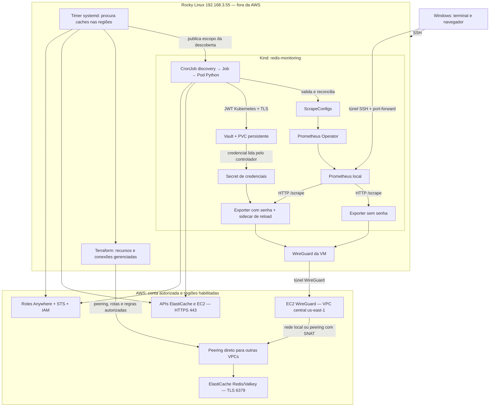

# Redis AWS no Prometheus local — guia resumido

## 1. O que o projeto faz

Descobre Redis/Valkey no Amazon ElastiCache e coleta suas métricas no
Prometheus de um Kubernetes **fora da AWS**, na VM Rocky Linux `192.168.3.55`.
Valkey é a engine usada nos testes; ElastiCache é o serviço gerenciado da AWS.

Existem duas etapas diferentes:

- **Descoberta:** lista caches com ou sem tags nas regiões habilitadas da conta.
- **Coleta:** conecta ao Redis, consulta suas informações e entrega métricas ao
  Prometheus. Exige rede, TLS e senha quando houver autenticação.

O inventário está em `/root/redis-network-automation/status.json`.
Ele ainda não é uma métrica publicada no Prometheus.

## 2. Fluxo completo



As setas representam as consultas; as respostas voltam pelo mesmo caminho.
Os Redis da VPC central usam a rede local do gateway, sem precisar de peering.
O TLS termina no Redis: o gateway encaminha os pacotes, não recebe a senha em
texto aberto. A API AWS é consultada separadamente, sem depender do túnel Redis.

## 3. Como funciona dentro do Kubernetes

**CronJob** é o agendamento. A cada minuto ele cria um **Job**, que executa um
**Pod Python**. O Pod consulta a AWS, lê o Vault, valida os alvos e termina.
`Completed` é o estado normal; o Pod não precisa ficar continuamente Running.

O controlador cria, atualiza e remove **ScrapeConfigs**, recursos do Prometheus
Operator. A remoção exige observações consecutivas e um período de segurança;
uma falha de API não autoriza apagar alvos existentes.

Os **Deployments** mantêm Vault e exporters continuamente disponíveis quando ON.
Os **Services** dão nomes e portas estáveis para os Pods. O **PVC vault-data**
preserva os dados do Vault entre desligamentos; não exclua o Kind nem esse PVC.

O **Secret exporter-credentials** contém o mapa de credenciais dos endpoints.
Ele é montado como volume no exporter autenticado. Um sidecar detecta a nova
geração, solicita reload e confirma a aplicação. Senhas não entram na URL do
alvo, nas labels ou no estado Terraform.

## 4. O que o exporter faz

O Prometheus solicita `/scrape` ao exporter na porta `9121`, indicando o alvo.
O exporter conecta ao Redis por TLS, autentica quando necessário e consulta
informações como memória, clientes e comandos. A resposta vira métricas.

Exemplos:

```promql
redis_up{discovery_type="aws"}
redis_memory_used_bytes{redis_name="rediscanada"}
redis_connected_clients{redis_name="rediscanada"}
```

`redis_up=1`: consulta Redis funcionou. `0`: falhou. Resultado vazio: não existe
uma série disponível para esse alvo. `up=1` sozinho confirma o scrape HTTP,
não garante que o exporter conseguiu consultar o Redis.

## 5. Para que serve cada serviço AWS

| Serviço/recurso | Função |
|---|---|
| ElastiCache | Executa Redis/Valkey; a API fornece inventário e tags |
| IAM | Define o que cada identidade pode consultar ou alterar |
| IAM Roles Anywhere | Usa certificado X.509 da VM/Pod para obter identidade AWS |
| STS | Fornece credenciais temporárias e permite AssumeRole quando configurado |
| EC2 WireGuard | Gateway entre o Rocky e a rede privada AWS |
| VPC / sub-redes | Redes regionais onde gateway e caches executam |
| VPC Peering | Conexão direta da VPC central às VPCs remotas |
| Tabelas de rotas | Determinam ida e retorno dos pacotes |
| Security groups / NACLs | Controlam quais conexões são permitidas |
| Systems Manager (SSM) | Aplica a configuração de encaminhamento/SNAT no gateway |
| EBS / IPv4 público | Disco e endereço da EC2; podem cobrar mesmo com ela parada |

ECS/Fargate e Amazon Managed Service for Prometheus (AMP) pertencem a testes
anteriores; não são necessários no fluxo atual. Logs CloudWatch eventualmente
existentes são separados das métricas armazenadas no Prometheus local.
O SNAT é feito pelo Linux da EC2, não por NAT Gateway. A VPN atual é WireGuard;
o piloto AWS Client VPN foi removido. Transit Gateway não faz parte deste fluxo.

## 6. Regiões, tags e autenticação

Cadastro de contas: o catálogo único, o bootstrap da segunda conta e a evolução
para Organizations/StackSets estão no [guia de ingresso de contas](CADASTRO_AUTOMATICO_CONTAS.md).
O modo atual Organizations resolve a OU sem cadastro individual. A segunda
conta real, `848349338183`, já integra a OU e passou no preflight de acesso.
O StackSet distribui a role às contas futuras da OU; consulte a
[etapa OU aplicada](ETAPA_OU_MONITORAMENTO.md). A rede cross-account ainda
precisa de validação antes de esperar métricas Redis dessa conta.

O timer `redis-regions.timer` consulta as regiões habilitadas da conta e repete
aproximadamente cinco minutos após terminar cada ciclo. O YAML é
`discovery/config/automatic-regions.yaml`. O CronJob de um minuto é outro processo.

Todos os Redis/Valkey encontrados aparecem no inventário. Para autorizar novas
alterações de rede e inclusão pela política atual, use:

```text
RedisObservability = vault-lab
```

Tags de negócio como `Project`, `Environment` e `CostCenter` viram labels
configuráveis. Sem a tag de adesão o cache continua visível no inventário,
mas não recebe automaticamente uma nova conexão de rede.

Senhas não podem ser recuperadas pela API ElastiCache. Devem ser cadastradas no
Vault, por conta, região e nome. Um cache sem AUTH não precisa de uma senha
inventada. Para Serverless, o modo de autenticação precisa de declaração explícita
conforme o [guia da automação](DESCOBERTA_REGIOES_AUTOMATICA.md).

CIDRs sobrepostos, comuns em VPCs default `172.31.0.0/16`, impedem roteamento
simples. A automação registra pendência; criar um Redis em qualquer VPC não
garante acesso. Uma conexão pertence à VPC, não a cada Redis ou AZ.

## 7. Passo a passo para iniciar e testar

Execute **na VM Rocky**, não no Git Bash do Windows:

```bash
cd /root/redis-vault-test-source
source /root/projetos/aws_redis_observability/.venv-aws/bin/activate
export AWS_PAGER=""
export KUBECONFIG=/root/.kube/config
kubectl config get-contexts
kubectl --context kind-redis-monitoring get nodes
aws sso login --profile redis-observability-admin
aws sts get-caller-identity --profile redis-observability-admin
terraform -chdir=terraform/environments/vault-lab init
terraform -chdir=terraform/environments/vault-lab apply -var='active=true'
```

ON pressupõe que a EC2 configurada e sua rede ainda existam. Recursos excluídos
na limpeza precisam ser recriados antes, com atualização do ID/IP do gateway,
configuração WireGuard e variáveis. `active=true` não recria uma EC2 removida.

Confira o Kubernetes:

```bash
kubectl -n redis-vault-lab get deployments,pods,services,pvc
kubectl -n redis-vault-lab get cronjobs,jobs
kubectl -n redis-vault-lab get scrapeconfigs
systemctl list-timers redis-regions.timer --no-pager
```

Espere Deployments disponíveis, Pods prontos, CronJob `SUSPEND=False` e Jobs
`Complete`. Para um teste reproduzível de um nó na Virgínia:

```bash
python scripts/vault_cache_test.py on
python scripts/verify_local_pipeline.py \
  --redis-name redis-vault-lifecycle-test --nodes --timeout 360 \
  --output /tmp/redis-verificado.json
```

Esse helper usa Terraform e a rede existente; cria um cache pago e prepara sua
credencial no Vault. No Console, também é possível criar um cache manualmente,
adicionar a tag de adesão e cadastrar a senha conforme o
[guia manual](GUIA_TESTE_MANUAL.md). Não é necessário cadastrar seu endpoint.

Para antecipar uma descoberta regional e consultar o resultado:

```bash
systemctl start redis-regions.service
cat /root/redis-network-automation/status.json
journalctl -u redis-regions.service -n 60 --no-pager
```

`missing_adoption_tag`: descoberto, sem autorização de rede por tag.
`tags_unavailable`: falha na leitura de tags, possível durante criação.
`inventory_fresh=false`: último inventário preservado após falha regional.
`collection_status=not_checked`: o inventário não validou as métricas.

## 8. Abrir o Prometheus

Na VM, deixe este terminal aberto:

```bash
kubectl -n monitoring port-forward \
  svc/monitoring-kube-prometheus-prometheus 19090:9090 --address=127.0.0.1
```

Em outro terminal **no Windows**:

```bash
ssh -N -L 19090:127.0.0.1:19090 root@192.168.3.55
```

Abra `http://127.0.0.1:19090` e consulte `redis_up{discovery_type="aws"}`.
SSH Windows→VM usa porta 22; a porta 2222 documentada é de administração da EC2.

## 9. Encerrar sem esquecer recursos cobrados

```bash
python scripts/vault_cache_test.py off
terraform -chdir=terraform/environments/vault-lab apply -var='active=false'
kubectl -n redis-vault-lab get deployments,pods,pvc,cronjobs,jobs
systemctl is-active redis-regions.timer
```

O helper OFF exclui somente seu cache temporário. Caches manuais em outras
regiões precisam ser excluídos separadamente. ElastiCache não tem pausa para
eliminar cobrança. OFF local preserva Vault/PVC/credenciais, suspende descoberta,
zera deployments e para a EC2 configurada, quando a autorização AWS está válida.

EC2 parada pode manter cobrança de EBS e IP público. Snapshots, logs, endpoints,
workspaces e outros serviços também exigem conferência. O relatório específico
do encerramento registra o que foi realmente removido e o que restou; não
interprete OFF como garantia de custo zero da conta.

## 10. O que já foi validado e o que ainda falta

- Validado: criação, descoberta, tags, Vault→Secret→exporter, rotação de senha,
  exclusão/recriação e métricas reais em `us-east-1`.
- Validado: inventário automático nas 17 regiões habilitadas, incluindo caches
  sem tags em Canadá e Mumbai; 86 testes passaram localmente e na VM.
- Preparado: automação de peering/rotas/SNAT; coleta Redis inter-regional ainda
  precisa de homologação real com rede e credencial disponíveis.
- Multiaccount real foi adiado. Redis autogerenciado/Sentinel, failover Multi-AZ,
  alta disponibilidade de Vault/gateway e SLA de cinco minutos ainda não estão
  homologados. O tempo dos ciclos e do provisionamento pode ultrapassar cinco
  minutos; descoberta não é garantia de coleta nesse prazo.

Referências: [fluxo detalhado](FLUXO_PONTA_A_PONTA.md),
[automação regional](DESCOBERTA_REGIOES_AUTOMATICA.md),
[operação e produção](OPERACAO_E_PRODUCAO.md).

## 11. Encerramento solicitado em 23/10/2026

| Componente | Resultado |
|---|---|
| `rediscanada` em ca-central-1 | Excluído, sem snapshot final |
| `redisasia` em ap-south-1 | Excluído, sem snapshot final |
| Serviços ECS antigos em sa-east-1 | Desired/running 0; nenhuma task em execução nas regiões consultadas |
| Duas EC2 VPN em us-east-1 | Paradas; preservadas para retomada |
| Discos das VPNs | Dois discos de 8 GiB preservados por escolha do usuário |
| Elastic IP da VPN | Preservado por escolha do usuário |
| Workspace AMP | Histórico preservado por escolha do usuário |
| EC2 externa `aws_lifecicle` | Terminada; disco de 16 GiB excluído com autorização |
| Timer e CronJobs do projeto | Parados/suspensos |
| Vault e exporters do laboratório | Zero réplicas; PVC preservado |

**Não é custo zero:** EBS, IPv4 público e armazenamento/histórico preservados
podem continuar gerando cobrança. Logs também foram preservados. Foram
inventariadas as 17 regiões habilitadas e os serviços descritos no relatório;
isso não substitui uma auditoria de faturamento de todos os produtos AWS.

Configuração WireGuard: backup privado verificado em
`/root/redis-vault-session/wireguard-before-shutdown.tgz`. Não copie seu conteúdo
para o Git ou chat. Mantenha também o PVC, a recuperação do Vault e os estados
Terraform. Como o gateway foi preservado, a retomada usa o ON da seção 7.

Verificação: [relatório do encerramento](evidence/shutdown-2026-10-23.json).
