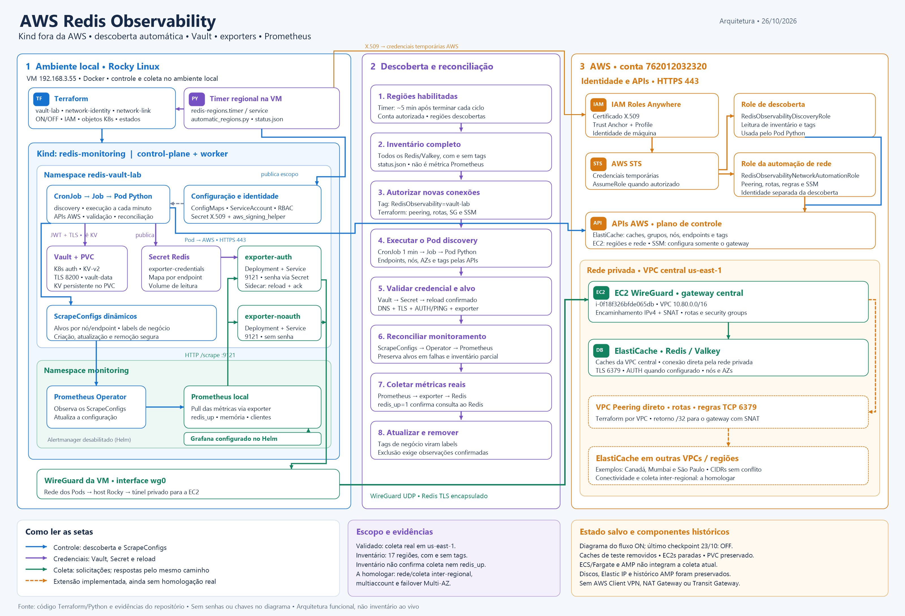

# Diagrama da arquitetura atual

- [PNG, 3200 × 2180 pixels](arquitetura-projeto-atual.png)
- [SVG vetorial editável](arquitetura-projeto-atual.svg)



Gerado em 26/10/2026 com base no código e na documentação do repositório.
Mostra a arquitetura funcional quando ligada. Não representa uma consulta ao
estado ao vivo da AWS: o último checkpoint, de 23/10, está em OFF.

Inclui Terraform, timer regional, Kind, namespaces, CronJob/Job/Pod Python,
ConfigMaps, ServiceAccount/RBAC, certificado X.509, Vault/PVC, Secret Redis,
exporters, reload, ScrapeConfigs, Operator, Prometheus, identidade IAM,
Roles Anywhere, STS, APIs AWS, EC2 WireGuard e ElastiCache.
Grafana aparece conforme configuração Helm; Alertmanager está desabilitado
nos valores. ECS/Fargate e AMP são históricos, fora da coleta atual.

Linhas tracejadas mostram a expansão inter-regional implementada, mas ainda
sem homologação de coleta real. Multiaccount e failover Multi-AZ também não
foram homologados. Inventário de caches sem tags não é prova de `redis_up`.

Para regenerar no Windows, sem dependências Python externas:

```powershell
python scripts/render_architecture_diagram.py
```

O gerador produz SVG e usa System.Drawing para exportar o PNG, com verificação
automática de largura dos textos. Fonte: Segoe UI; os elementos são vetoriais e
reproduzíveis pelo código.
